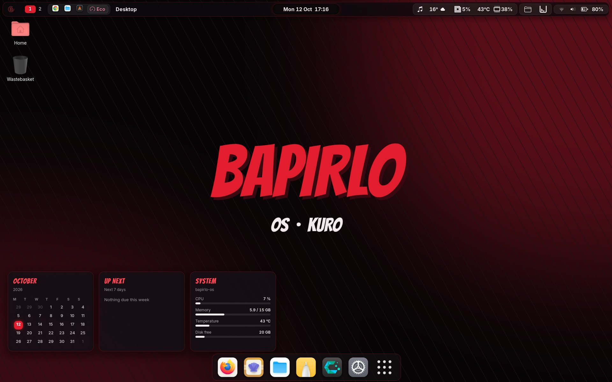
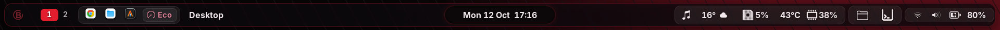
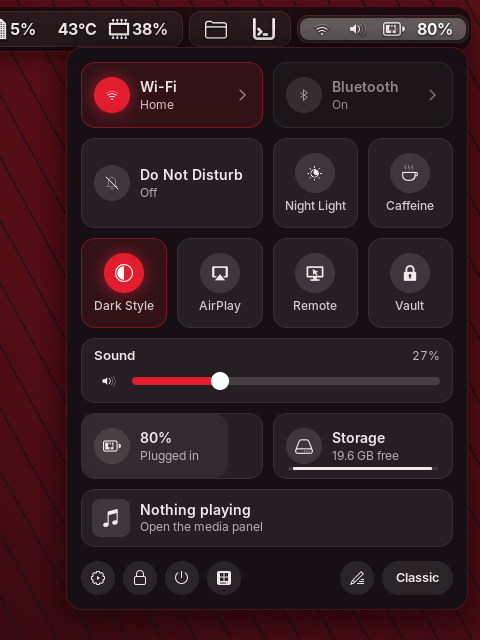
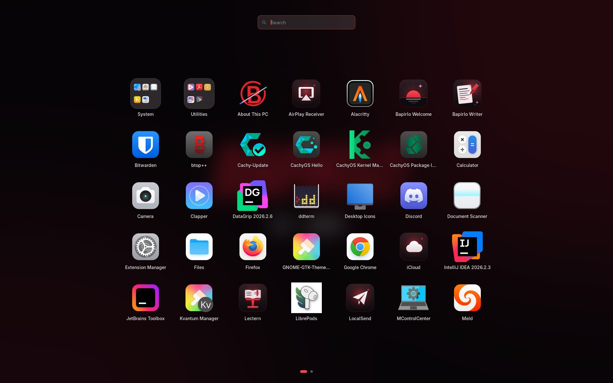
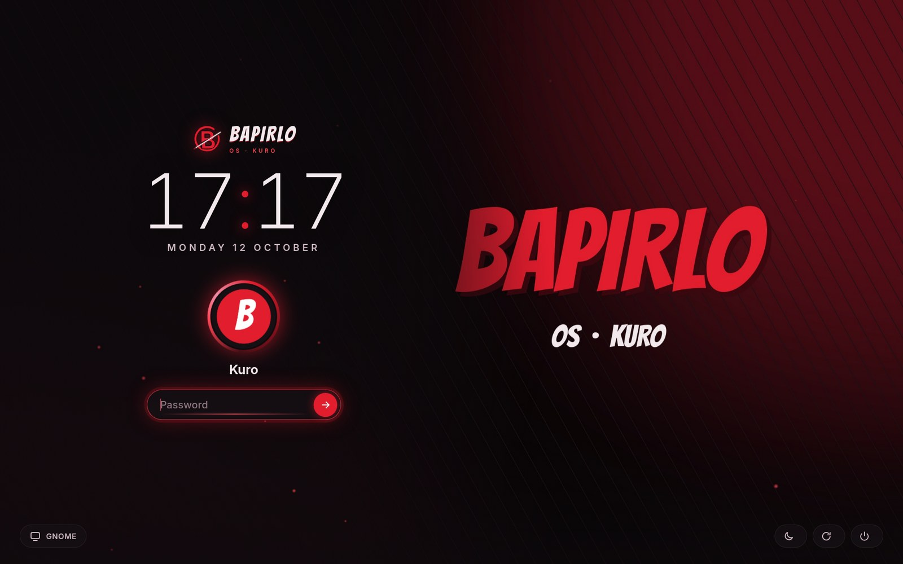
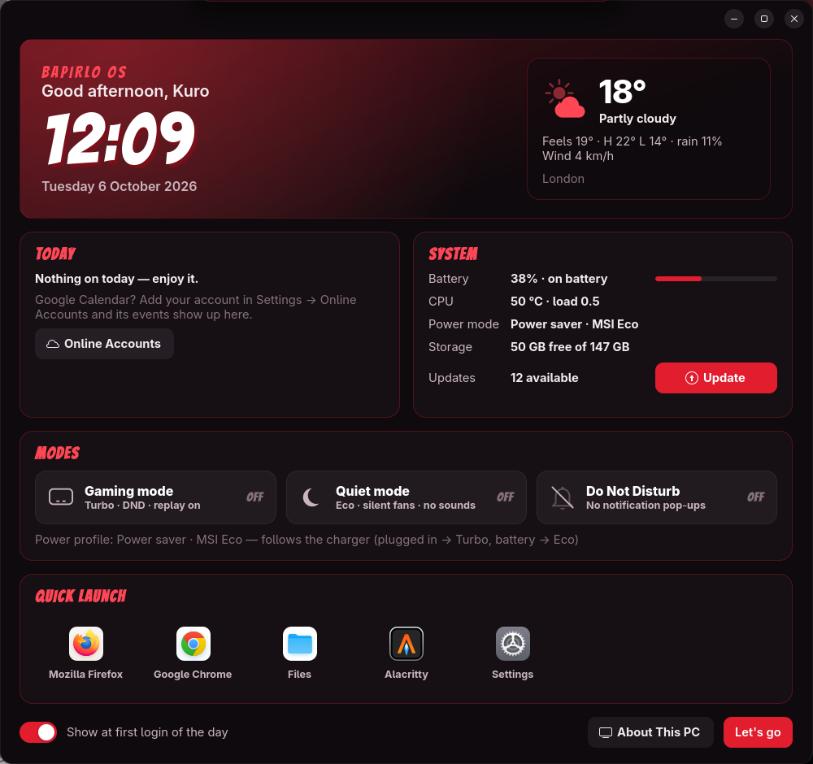

<p align="center">
  
</p>

<h1 align="center">KURO OS · <i>Kuro</i></h1>

<p align="center">
  A manga-styled, ink-black and crimson GNOME desktop on top of CachyOS:
  themed from the first boot frame to the shutdown splash, with Mac-style controls,
  and built to stay out of the way while gaming and streaming.<br>
  <b>CachyOS · GNOME 51 (Wayland) · LightDM · MSI Pulse 16 (Intel + RTX 4060)</b>
</p>

<p align="center"></p>

---

## Features

**One look, everywhere.** A single palette (`tools/palette.py`: ink `#0E0A0D`, crimson `#E11D2E`, ember `#FF4655`,
sakura `#F08AA4`, paper `#F2E9EC`) themes GRUB, Plymouth, the login screen, GNOME Shell, GTK3/GTK4/libadwaita,
Qt (Kvantum), the terminal, Spotify, Discord and Chrome.

| Area | What you get |
|---|---|
| **Boot & login** | GRUB theme, Plymouth "awakening" splash per monitor (*See you soon* / *Be right back* on shutdown and reboot), an animated web-greeter login that is also the lock screen |
| **Top bar** | Capsule layout: Kuro logo with a Mac-style menu, workspace numbers, quick launch, power-mode chip, app name, a **Dynamic Island** clock, then media, weather, CPU, places, drives, tray and Control Centre. It hides over fullscreen apps and comes back from the top edge |
| **Control Centre** | Mac-style tiles for Wi-Fi, Bluetooth (with device lists), power mode, Do Not Disturb, Night Light, Caffeine, screen recording, Dark Style, sound, brightness, AirPlay, remote access, captions, Vault, battery, storage, now playing, and **Restart to Windows** |
| **Theme Studio** | Re-theme everything from a wallpaper (matugen palette in the Kuro shape, WCAG AA-checked), with a live preview, a cross-fade instead of a logout, saved presets and an exact *Original* restore. Optional boot splash. `studio/` |
| **Dynamic Island** | The clock capsule grows to show volume and brightness, media, notifications, battery and screenshots |
| **Launchpad & desk** | Full-screen app grid on Super+G, desktop widgets (calendar, *up next*, system), a login briefing, picture-in-picture kept on top, and privacy dots for the mic, camera and screen sharing |
| **Gaming** | A fullscreen game turns on DND, holds the Performance profile and starts a 30 s instant-replay buffer on the iGPU encoder. MangoHud and an OBS hook are included |
| **Laptop (MSI)** | `msi-ec` + `bapirlo-perfd`: Turbo on AC, Eco + silent fans on battery, 80 % charge limit |
| **iPhone & Windows** | LocalSend (AirDrop-style), an AirPlay receiver, KDE Connect, an iCloud web app, AirPods battery (LibrePods), the Windows drive in Files (read-only by default, with a safety check), a shared folder, Bluetooth key sync, and one-shot *Restart to Windows* (EFI BootNext) |
| **Productivity** | Kuro Writer (Claude rewrite + offline LanguageTool), Super+A Claude Code terminal, an encrypted Vault, a daily Downloads tidy, clipboard history, emoji picker, Satty screenshots |
| **Staying healthy** | A Timeshift snapshot before every update (keeps 3). **Kuro Doctor** runs after every update and login, and tells you when an extension no longer supports the new GNOME. Spotify's theme is re-applied after Spotify updates. A monthly cleanup runs too |
| **Docs** | A full plain-English manual in a themed **Kuro OS Guide** app ([MANUAL.md](MANUAL.md)) and a one-page [emergency sheet](EMERGENCY.md) ([PDF](EMERGENCY.pdf)) |

Everything is a plain script. Each one **backs up before it changes anything** (into `~/theme-backups`) and has its own `restore`.

## Screenshots

| | |
|---|---|
|  | |
|  |  |
|  |  |

<sub>Screenshots use a neutral wallpaper. The real theme is generated from whatever picture you give the installer.</sub>

## Install (fresh CachyOS + GNOME)

Requirements: CachyOS with the GNOME desktop (GNOME 50 or 51), your normal user with sudo, internet, and about 6 GB free.
The theme is built around **your own wallpaper**. The original art is third-party and is not in this repo.

```bash
sudo pacman -S --needed git
git clone https://github.com/Bapirlo07/kuro-os.git ~/bapirlo-os
cd ~/bapirlo-os
./install.sh --dry-run --wallpaper ~/Pictures/your-art.jpg        # see every step first
./install.sh --wallpaper ~/Pictures/your-art.jpg --city "London" --lat 51.51 --lon -0.13
# optional: theme GRUB, Plymouth and the login screen too (read 50-boot-v2.sh first — machine-specific)
./install.sh --wallpaper ~/Pictures/your-art.jpg --boot
```

The installer:
- takes a Timeshift snapshot **"Before Kuro OS"** first;
- shows every package and asks before installing it (AUR packages go through `paru`, which shows each PKGBUILD);
- never touches partitions, `/etc/fstab`, the EFI partition or your boot loader configuration (unless you pass `--boot`, which themes GRUB).

Log out and back in at the end, then open **Kuro OS Guide** and run **Kuro Doctor**.

**Undo:** every script has `bash <script>.sh restore`, or restore the "Before Kuro OS" snapshot in Timeshift.

## Layout

| Path | What |
|---|---|
| `NN-*.sh` | One script per step, in the order they were made (`install.sh` runs them in order) |
| `bar/` `control-centre/` `dynamic-island/` `media-widget/` `desk/` `game/` `ai/` `sounds/` `session/` | Kuro's own GNOME Shell extensions (most have a headless test harness in `test/`) |
| `apps/` | Welcome, About, **Guide**, app themes (Spicetify, Vesktop, Chrome, VS Code, Starship, cava) |
| `writer/` | Kuro Writer (GTK4) |
| `bin/` | The `bapirlo-*` commands (`bapirlo-doctor`, `bapirlo-mode`, `bapirlo-vault`, `bapirlo-restart-windows` …) |
| `windows/` | Dual-boot helpers (`bapirlo-windows`, `bapirlo-bt-sync`) |
| `greeter/` | The web-greeter login / lock screen theme |
| `config/settings.dconf` | Exported GNOME + extension settings, with personal data removed (`tools/export-settings.py`) |
| `round2/` `round3/` `round7/` `final/` | Units, polkit rules, icons and configs those rounds install |
| `tools/` | Palette, art builders, icon generators, the settings exporter |
| `MANUAL.md` · `EMERGENCY.md` | The manual and the emergency sheet |

## Credits

GNOME and every extension author (ArcMenu, Blur my Shell, Burn My Windows, Dash2Dock Animated, Vitals, Logo Menu,
Just Perfection, Lock Keys, Bluetooth Battery Meter, Alphabetical App Grid, Wiggly, GSConnect, Coverflow Alt-Tab, ddterm,
Rounded Window Corners Reborn, Desktop Cube, SimpleWeather, Clipboard Indicator, Emoji Copy, Caffeine, Arch Update,
Smart Auto Move NG, DING). WhiteSur by vinceliuice. Bangers font (OFL). Kenney sound effects (CC0). CachyOS.
